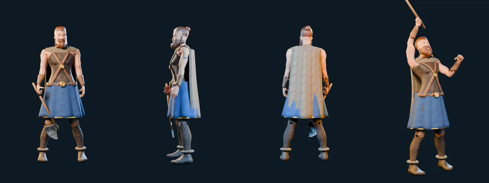
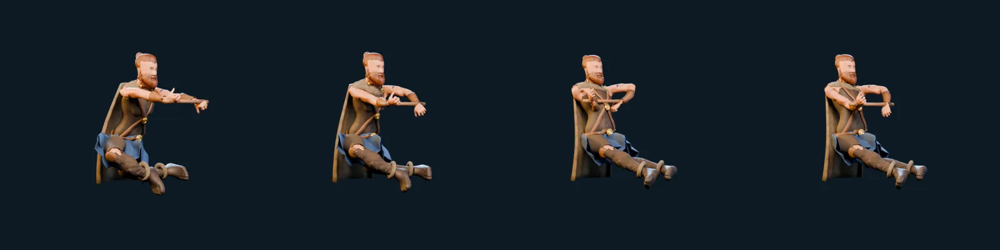
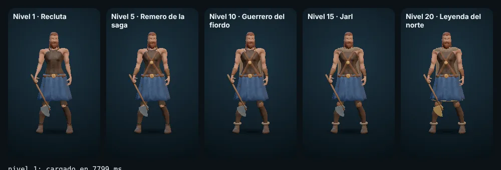

# Personajes 3D

Sistema de personajes en 3D de ROWR: el vikingo se construye en Blender por script, se exporta a GLB y la app lo
muestra con Three.js en la ficha del héroe y en el panel de entrenamiento. Las otras clases siguen con su
ilustración WebP hasta que tengan modelo.

| Documento | Contenido |
| --- | --- |
| [PIPELINE.md](PIPELINE.md) | Cómo se construye el personaje en Blender: cuerpo, equipo, materiales, rig y animaciones |
| [EXPORTACION.md](EXPORTACION.md) | Convenciones del GLB, optimización y medidas reales |
| [NUEVA_CLASE.md](NUEVA_CLASE.md) | Pasos para añadir otra clase |
| [LIMITACIONES.md](LIMITACIONES.md) | Lo que falta, lo que no se pudo comprobar y decisiones tomadas |





## Archivos

| Ruta | Qué es |
| --- | --- |
| `tools/blender/makehuman/` | Malla base, objetivos de forma, esqueleto, pesos y ojos de MakeHuman (CC0) y `mh.py`, que los lee sin instalar MakeHuman |
| `tools/blender/vikingo/vikingo.py` | Script principal: cuerpo y rig; ejecuta `escena.py`, `equipo.py`, `animaciones.py` y `salidas.py` |
| `tools/blender/vikingo/vikingo.blend` | Escena de Blender resultante, para retocar a mano (se regenera con `exportar.sh`) |
| `tools/blender/vikingo/exportar.sh` | Construye y optimiza los GLB de la app |
| `tools/blender/vikingo/medir.mjs` | Mide un GLB (MB, triángulos, huesos, texturas, animaciones) |
| `assets/personajes3d/vikingo/vikingo.glb` | Modelo de calidad alta (texturas 1K) |
| `assets/personajes3d/vikingo/vikingo_movil.glb` | Modelo ligero (texturas 512, geometría simplificada); el que usa la app por defecto |
| `personajes3d/config.js` | Clases con modelo, animaciones y variantes por nivel (datos y funciones puras) |
| `personajes3d/visor.js` | `VisorPersonaje`: el visor Three.js |
| `vendor/three/` | Three.js r169 (MIT) y los complementos que usa el visor, servidos localmente |
| `tools/personajes3d/visor-prueba.html` | Banco de pruebas del visor (no forma parte de la app) |
| `pruebas/personajes3d.test.mjs` | Pruebas de la configuración y de los GLB |

## Uso del visor

```js
import { VisorPersonaje } from './personajes3d/visor.js';
const v = new VisorPersonaje(caja, {
  clase: 'vikingo',      // characterId / classId
  nivel: 12,             // elige la variante de equipo
  animacion: 'idle',     // 'preview' | 'idle' | 'rowing' | 'victory'
  camara: 'auto',        // 'cuerpo' | 'retrato' | 'remo' | 'victoria' | 'auto' (según la animación)
  fondo: null,           // null = transparente, o un color '#0B1217'
  calidad: 'auto',       // 'alta' | 'movil' | 'auto'
  interactivo: true,     // arrastrar en horizontal lo gira
  alCargar: (v) => {}, alFallar: (error) => {},
});
await v.cargar();        // rechaza si no hay WebGL, falla la red o el GLB
v.animacion('rowing'); v.velocidad(spm / 37.5); v.nivel(20); v.camaraPreset('retrato');
v.montar(otraCaja);      // mover el lienzo sin recargar
v.destruir();            // libera geometrías, materiales, texturas, entorno y el contexto WebGL
```

En la app (`app.js`):

- **Ficha del héroe**: se pinta la ilustración WebP y, si la clase tiene modelo, el visor la tapa al terminar de
  cargar. Debajo aparecen Reposo / Remar / Victoria y el nombre de la variante. Si algo falla, queda la ilustración.
- **Entrenamiento**: con la remadora conectada o durante la sesión aparece un panel de 150 px con el héroe remando
  al ritmo de tus golpes por minuto (se detiene si dejas de remar).
- El visor se reutiliza al repintar la vista (un solo GLB descargado, un solo contexto WebGL por panel).

## Rendimiento

- Three.js y el modelo solo se descargan al abrir un visor (importación dinámica); la app arranca igual que antes.
- Sin sombras dinámicas: una sombra de contacto falsa (degradado) y luces direccionales sin mapa de sombras.
- Solo hay bucle de dibujo si el lienzo se ve (IntersectionObserver), la pestaña está activa, la animación avanza y
  no hay `prefers-reduced-motion`. En la versión móvil se limita a 30 fps y el `devicePixelRatio` a 1,5.
- Con movimiento reducido se dibuja una pose fija y no hay bucle.
- El service worker precarga el visor y el modelo móvil como las ilustraciones (si falla, la app queda instalada igual).
