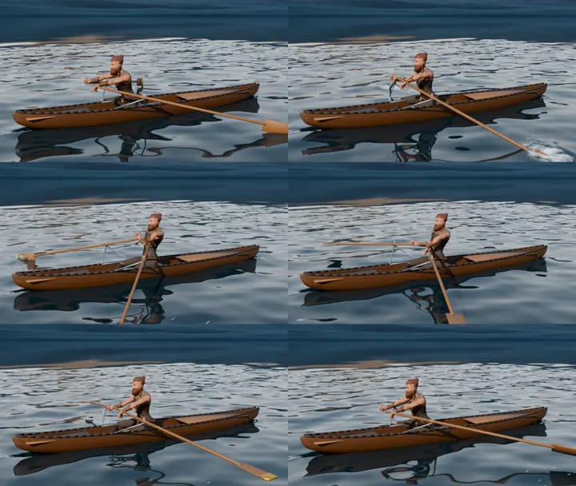

# Vista realista de la carrera: el vikingo remando en el fiordo

Clip renderizado en Blender (Cycles) del vikingo remando en una barca de madera por el fiordo, con remos, agua,
reflejos, espuma y salpicaduras, y los rivales remando en sus carriles detrás de ti. La carrera lo muestra como tercera vista (2D → 3D → realista) cuando tu héroe es
el vikingo. Con otra clase, el ciclo es 2D → 3D y, si tenías elegida la realista, se ve la 3D.



## Cómo se genera

```bash
python tools/blender/vikingo/vikingo.py --salida /tmp/vk                     # .blend y texturas del vikingo
python tools/blender/remo_agua/remo_agua.py --blend /tmp/vk/vikingo.blend --salida /tmp/remo --res 960x540 --muestras 32
python tools/blender/remo_agua/remo_agua.py --blend /tmp/vk/vikingo.blend --salida /tmp/remo_v --camara vertical --res 540x720 --muestras 32
python tools/blender/remo_agua/remo_agua.py --blend /tmp/vk/vikingo.blend --salida /tmp/rival --sprite --frames 1-48 --res 960x540 --muestras 24
python3 tools/blender/remo_agua/atlas_rival.py /tmp/rival assets/carrera/rival_vikingo.webp 0.55   # imprime RIVAL_REAL
tools/blender/remo_agua/codificar.sh /tmp/remo 960      # → assets/carrera/remo_vikingo.mp4
tools/blender/remo_agua/codificar.sh /tmp/remo_v 540    # → assets/carrera/remo_vikingo_v.mp4
```

Con 4 núcleos de CPU, cada fotograma tarda unos 13 s; los 96 fotogramas de un clip tardan unos 20 minutos.

## Qué hace `remo_agua.py`

- **Palada**: se vuelve a hornear la acción `rowing` con el mismo IK, pero con las manos más bajas en la recuperación
  para sacar la pala del agua. Dura 48 fotogramas (1,6 s, 37,5 golpes/min).
- **Barca y remos**: casco de tingladillo, asiento corredizo que sigue a la cadera, reposapiés y horquillas de
  hierro. Cada remo gira en su perno siguiendo la mano (`DAMPED_TRACK`) y se plumea (pala plana) en la recuperación.
  La altura de los pernos se ajusta sola hasta que la pala queda sumergida durante el empuje.
- **Agua**: malla densa cerca de la barca (5 cm) que se abre hacia el horizonte. Las olas son una suma de ondas con
  vectores enteros en una tesela de 12 m y frecuencias múltiplo de 2π/3,2 s, y la barca avanza una tesela por bucle,
  así el clip **cierra sin salto**. No se usa el modificador Ocean porque su espectro no se repite en el tiempo. Los
  rizos finos son un mapa de relieve periódico que corre con el agua.
- **Espuma y salpicaduras**: remolino alrededor de la pala en el empuje, charcos que se quedan atrás, estela en uve
  detrás de la popa, gotas al entrar y al sacar la pala y goteo en la recuperación (gotas estiradas según su
  velocidad, en lugar de desenfoque de movimiento).
- **Cielo**: el panorama del fiordo de la carrera (`assets/carrera/fiordo.webp`) a media altura, degradado de cielo
  encima y sol bajo y cálido.

Para que no atraviesen la barca se ocultan la capa, la falda, las rodilleras y el hacha.

## En la app

- `carrera.js` (`pintarReal`) descarga el clip como blob (pasa por la caché del service worker y funciona sin
  conexión y en Safari) y lo dibuja cubriendo el lienzo.
- **Rivales** (`rivalesReal`): el bote rival es el mismo render sin agua sobre fondo transparente (`--sprite`), una
  palada de 48 fotogramas empaquetada en `rival_vikingo.webp` (~300 KB). Cada rival va en su carril (el primero a 6 m de ti y los demás 4,5 m más lejos cada uno)
  y se proyecta con la cámara del clip (`camara.json` → `CLIPS_REAL`): delante de ti queda a la
  derecha y detrás a la izquierda. La distancia se comprime (`distReal`, tanh) para que quepan todos; la etiqueta
  sobre la cabeza dice la diferencia real. Rema con su propia fase y lleva un reflejo tenue en el agua. Si se sale
  del cuadro, una flecha en el borde. Sustituye a la tabla de diferencias de las otras vistas.
- El encuadre centra bajo la cabecera el recuadro que ocupan tu bote y los rivales.
- La velocidad del clip es tus golpes por minuto / 37,5 (entre 0,4× y 2,5×). En pausa, sin paladas o con
  «reducir movimiento», el clip se queda quieto, y se pausa cuando no se ve.
- Con el lienzo apaisado se usa `remo_vikingo.mp4` (960×540, ~500 KB) y con el lienzo vertical
  `remo_vikingo_v.mp4` (540×720, ~310 KB). Mientras carga se ve la vista 3D.

## Límites

- Solo existe para el vikingo y el fiordo: con la laguna tropical se ve el fiordo igualmente.
- Todos los rivales usan el mismo bote con el vikingo (no hay modelos 3D de las otras clases); se distinguen por la
  etiqueta de su color.
- Los rivales se pintan encima del clip: si uno queda justo detrás de tu popa, sus remos pueden pisar tu bote.
- Las distancias entre botes no están a escala más allá de unos metros (la etiqueta sí dice la real).
- La palada del clip va a su ritmo, no sincronizada con tu palada real (la remadora da golpes/min, no la fase).
- La animación no es captura de movimiento y el personaje es el vikingo estilizado del pipeline.
